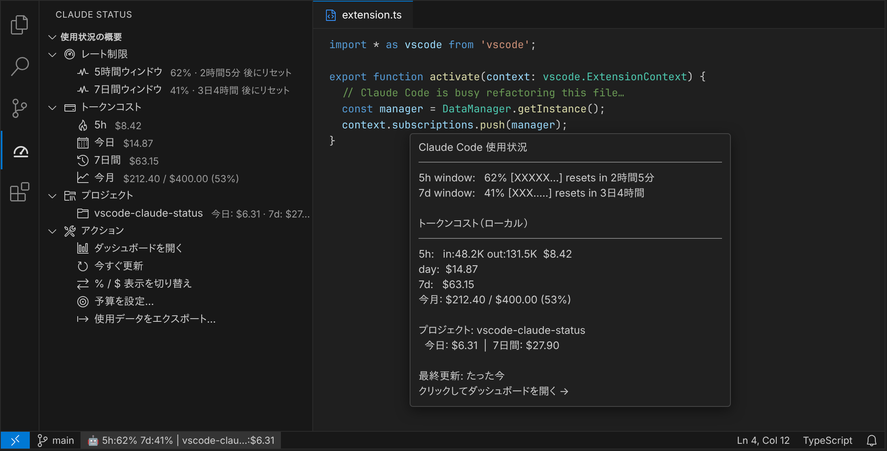
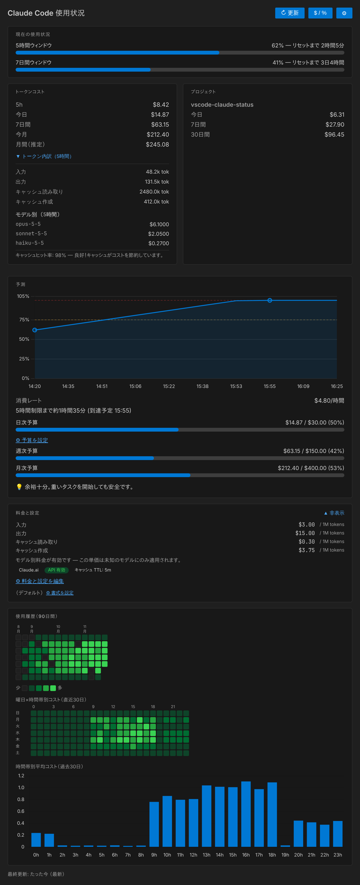

<div align="center">


# vscode-claude-status

**Claude Code のトークン使用量とコストを、VS Code のステータスバーに常時表示。**

[](https://marketplace.visualstudio.com/items?itemName=long-kudo.vscode-claude-status)
[](https://open-vsx.org/extension/long-kudo/vscode-claude-status)
[](https://marketplace.visualstudio.com/items?itemName=long-kudo.vscode-claude-status)
[](https://marketplace.visualstudio.com/items?itemName=long-kudo.vscode-claude-status)
[](https://code.visualstudio.com/)
<br>
[](LICENSE)
[](https://github.com/long-910/vscode-claude-status/actions/workflows/ci.yml)
[](https://github.com/long-910/vscode-claude-status/actions/workflows/release.yml)
[](https://github.com/sponsors/long-910)
[](https://ko-fi.com/long910)

🌐 [English](README.md) · **日本語** · [中文](README.zh.md)



</div>

## 特長

- **レート制限がひと目でわかる** — Claude.ai プランの 5時間・7日間の使用率をステータスバーに表示
- **いくら使ったか** — 直近5時間・今日・7日間・今月のトークンコストを、モデルごとの単価で計算
- **プロジェクト単位** — 開いているワークスペースの今日・今週・今月のコスト
- **上限の前に気づける** — 消費ペース、5時間制限に達するまでの時間、日次 / 週次 / 月次予算とアラート
- **長期の傾向** — 90日間のヒートマップ、時間帯別グラフ、曜日 × 時間帯のパンチカード
- **ローカルで軽量** — Claude Code 自身のトランスクリプトを読むだけ。通信はごく小さなレート制限の確認のみで、
  それも Claude Code の使用中に限られます（[詳細](#プライバシーと通信)）

## クイックスタート

1. [VS Code Marketplace](https://marketplace.visualstudio.com/items?itemName=long-kudo.vscode-claude-status) または
   [Open VSX](https://open-vsx.org/extension/long-kudo/vscode-claude-status) から **Claude Status** をインストール
2. いつも通り Claude Code を使うと、ステータスバーに `🤖 5h:45% 7d:32%`（従量課金プランではコスト）が表示されます。
   設定や追加のログインは不要です
3. **ステータスバーをクリック**するとダッシュボード、アクティビティバーの **Claude Status** でサイドバーが開きます

---

## 機能

### 📊 ステータスバー

常に表示されるコンパクトなサマリーです。ホバーでトークン内訳とリセット時刻、クリックでダッシュボードを開きます。

| 状態 | 表示例 |
|------|--------|
| 通常（%モード、Claude.ai） | `🤖 5h:45% 7d:62%` |
| 警告 ≥ 75% | `🤖 5h:78%⚠ 7d:84%⚠` |
| レート制限到達 | `🤖 5h:100%✗` |
| 7日間ウィンドウのないプラン | `🤖 5h:45%` |
| コストモード | `🤖 5h:$14.21 7d:$53.17` |
| 従量課金（APIキー・Bedrock・従量課金のエンタープライズ） | `🤖 5h:$0.15 7d:$0.42` |
| 従量課金で `payAsYouGo.showTimeWindows: false` | `🤖 Today:$0.15` |
| メーター付き（`statusBar.showSparkline`） | `🤖 5h:▰▰▰▱▱ 62% 7d:41%` |
| プロジェクトコスト付き | `🤖 5h:78% 7d:84% \| my-app:$3.21` |
| マルチルートワークスペース（フォルダーの合計） | `🤖 5h:78% 7d:84% \| PJ:$5.43` |
| キャッシュ値（API に届かない / 無効） | `🤖 5h:78% 7d:84% [10m ago]` |
| 未ログイン | `🤖 Not logged in` |

表示形式は `claudeStatus.statusBar.format` で自由にカスタマイズできます — [設定](#設定) を参照。

### 🧭 サイドバー

アクティビティバーの **Claude Status** アイコンから、レート制限ウィンドウ・トークンコスト（5時間 / 今日 / 7日間 / 今月と月次予算）・
プロジェクト別コスト・クイックアクションをネイティブのツリービューで確認できます。ダッシュボードを開かなくても主要な数値が見られます。

### 🗂 ダッシュボード

ステータスバー（または **Claude Status: ダッシュボードを開く**）から、すべての情報を1画面で確認できます。

| カード | 内容 |
|---|---|
| **現在の使用状況** | 5時間・7日間の使用率バーとリセットまでの時間 |
| **トークンコスト** | 5時間 / 今日 / 7日間 / 今月 / 月間推定。展開するとトークン内訳・モデル別コスト・キャッシュヒット率 |
| **プロジェクト** | ワークスペースフォルダーごとの今日 / 7日間 / 30日間 |
| **予測** | リセットまでの5時間使用率の予測グラフ、消費レート、日次 / 週次 / 月次予算のバー |
| **料金と設定** | 適用中のトークン単価・プロバイダー・API の状態・キャッシュ TTL と設定へのリンク |
| **使用履歴** | 日次ヒートマップ、曜日 × 時間帯のパンチカード、時間帯別の平均コスト |

VS Code のライト・ダーク・ハイコントラストテーマに追従します。

<div align="center">

</div>

### 📁 プロジェクトコスト

開いているワークスペースフォルダーを Claude Code のセッションディレクトリに自動で対応付け、**このプロジェクト**に
かかったコスト（今日・直近7日間・直近30日間）を表示します。マルチルートワークスペースでは、ダッシュボードにフォルダーごとの内訳、
ステータスバーに合計が表示されます。

### 🔮 予測と予算

直近30分のアクティビティから5時間制限に達する時刻を推定し、事前に警告します。

- **消費レート**（$/時間）と **5時間制限までの残り時間**（次のリセット時刻が上限）
- 残り30分以上なら「重いタスクを開始しても安全です」などのアドバイス
- 任意の **日次・週次・月次** USD 予算とプログレスバー — 月次予算はエンタープライズの利用上限（spend limit）の管理に便利
- **通知**: 残り30分以下で警告、10分以下で「ダッシュボードを開く」付きのエラー。予算アラートは1日 / 1か月に最大1回

日次予算は **Claude Status: 予算を設定...** から、その他は設定画面から指定します。

### 📅 使用履歴

- **日次ヒートマップ** — 直近 30 / 60 / 90 日（`claudeStatus.heatmap.days`）。セルにホバーで日付とコスト
- **パンチカード** — 直近30日の曜日 × 時間帯ごとのコスト（「月曜の午前」のような傾向がわかる）
- **時間帯別グラフ** — Claude Code をよく使う時間帯
- **エクスポート** — **Claude Status: 使用履歴をエクスポート...** で日次履歴を CSV / JSON に保存

---

## 対応プラン

プランは自動で判定されます。追加のログインは不要です。

| プラン | 判定に使う情報 | ステータスバー | レート制限 API |
|---|---|---|---|
| Claude.ai Pro / Max、シート型の Team / Enterprise | `claude login` の認証情報（`~/.claude/.credentials.json` または macOS キーチェーン） | `5h:45% 7d:32%` — 週間ウィンドウのないプランでは 7d は自動で非表示 | Claude Code の使用中のみ、最大5分に1回 |
| 従量課金の Claude.ai プラン（従量課金のエンタープライズなど） | Claude Code のアカウント情報（`~/.claude.json` の `billingType: "usage_based"`） | コストのみ | 呼び出さない |
| Anthropic API キー | `ANTHROPIC_API_KEY` | コストのみ | 呼び出さない |
| AWS Bedrock | AWS の環境変数 | コストのみ | 呼び出さない |

従量課金のプランでは、`claudeStatus.payAsYouGo.showTimeWindows: false` で 5h / 7d の代わりに今日のコストを表示でき、
`claudeStatus.budget.monthlyUsd` で利用上限を管理できます。判定が合わない場合は `claudeStatus.claudeProvider` を指定してください。
詳細: [docs/PLANS.md](docs/PLANS.md)（英語）。

> 作者は Claude.ai Pro プランで開発・テストしています。その他のプランはベストエフォートでの対応です。
> 想定外の動作があれば、プラン種別を添えて [Issue](https://github.com/long-910/vscode-claude-status/issues) を作成してください。

---

## プライバシーと通信

- **トークンコストはローカルで計算**します。読み取るのは `~/.claude/projects/**/*.jsonl`（または `claudeStatus.claudeHome`）
  だけで、何もアップロードしません。
- **レート制限 % の取得にだけ、ごく小さな API 呼び出し**を使います（Claude.ai サブスクリプションのみ）。1回あたり
  `claude-haiku-4-5` で約9トークン（≈ $0.00013）、最大5分に1回、**Claude Code の使用中のみ**。月間の目安は **$0.01 未満**です。
  従量課金のプランでは API を一切呼びません。
- `claudeStatus.rateLimitApi.enabled: false` で API 呼び出しを完全に止められます。最後にキャッシュした % は `[Xm ago]` 付きで
  表示され続け、キャッシュがなければコストのみの表示になります。

> [!WARNING]
> **コストは概算です。** Anthropic の API 定価（2026-10-31 確認）で計算しています。個別契約の割引・シート料金・
> パートナー（Bedrock / Vertex）の料金は含みません。組み込みの単価表より新しいモデルは同じファミリーの最新単価で概算します。
> 正確な単価は `claudeStatus.pricing.modelOverrides` で設定できます — [docs/PRICING.md](docs/PRICING.md)（英語）参照。

---

## 必要条件

- **VS Code 1.82** 以降
- **Claude Code** のセッションが1つ以上あること

> [!IMPORTANT]
> 0.9.0 から最低バージョンは VS Code **1.82**（以前は 1.73）です。レート制限 % の取得に使う global の `fetch` API は、
> 拡張機能ホストでは 1.82（Node.js 18）から利用できるためです。VS Code 1.81 以前では拡張機能 0.7.0 を使うか、
> VS Code を更新してください。

## インストール

**Marketplace** — 拡張機能ビューで **「Claude Status」** を検索するか、次を実行:

```bash
code --install-extension long-kudo.vscode-claude-status
```

**VSIX** — [Releases](https://github.com/long-910/vscode-claude-status/releases) から `.vsix` をダウンロードし、
**拡張機能 (Ctrl+Shift+X)** → **⋯** → **VSIX からのインストール…**

**ソースからビルド**

```bash
git clone https://github.com/long-910/vscode-claude-status.git
cd vscode-claude-status
npm install
npx @vscode/vsce package   # → vscode-claude-status-<version>.vsix
```

---

## コマンドとショートカット

拡張機能は VS Code の起動時に自動で開始します。

| コマンド / 操作 | 動作 |
|-----------|------|
| ステータスバーをクリック | ダッシュボードを開く |
| `Ctrl+Shift+Alt+C`（Mac は `⌘⇧⌥C`） | `%` ↔ `$` を切り替え |
| **Claude Status: ダッシュボードを開く** | ダッシュボードを開く |
| **Claude Status: 今すぐ更新** | すべてのデータを今すぐ更新 |
| **Claude Status: % / $ 表示を切替** | ステータスバーの % / コスト表示を切り替え |
| **Claude Status: 予算を設定...** | 日次 USD 予算を設定 / 無効化 |
| **Claude Status: 使用履歴をエクスポート...** | 日次の使用履歴を CSV / JSON で保存 |

---

## 設定

すべての設定は VS Code 設定の `claudeStatus` 以下にあります。全項目のリファレンス: [docs/SETTINGS.md](docs/SETTINGS.md)（英語）。

### 表示

| 設定 | デフォルト | 説明 |
|------|---------|------|
| `claudeStatus.displayMode` | `"percent"` | ステータスバーを `"percent"`（%）か `"cost"`（$）で表示 |
| `claudeStatus.statusBar.alignment` | `"left"` | `"left"` または `"right"` |
| `claudeStatus.statusBar.showProjectCost` | `true` | ステータスバーに現在のプロジェクトのコストを表示 |
| `claudeStatus.statusBar.format` | `null` | カスタムラベル（例: `"${usage5h}% \| $${costDay}"`）。プレースホルダー: `${usage5h}`, `${usage7d}`, `${bar5h}`, `${bar7d}`, `${cost5h}`, `${cost7d}`, `${costDay}`, `${costMonth}`, `${reset5h}`, `${reset7d}` |
| `claudeStatus.statusBar.showSparkline` | `false` | % の横にコンパクトな 5h メーター（▰▰▰▱▱）を表示 |
| `claudeStatus.payAsYouGo.showTimeWindows` | `true` | 従量課金のプランで `false` にすると、5h / 7d の代わりに今日のコストを表示（サブスクには影響なし） |
| `claudeStatus.heatmap.days` | `90` | 使用履歴ヒートマップの日数（30 / 60 / 90） |

### プラン・データソース・API

| 設定 | デフォルト | 説明 |
|------|---------|------|
| `claudeStatus.claudeProvider` | `"auto"` | `"auto"`、`"claude-ai"`、`"claude-ai-usage"`（従量課金の Claude.ai プラン）、`"aws-bedrock"`、`"api-key"` |
| `claudeStatus.claudeHome` | `".claude"` | Claude Code のデータディレクトリ（ホームからの相対パス。絶対パスと `~` も可）。ユーザー設定のみ |
| `claudeStatus.credentials.path` | `null` | 認証情報ファイルのカスタムパス。ユーザー設定のみ |
| `claudeStatus.rateLimitApi.enabled` | `true` | レート制限 % を取得（サブスク）。オフ: API を呼ばず、最後にキャッシュした % を `[Xm ago]` 付きで表示 |
| `claudeStatus.cache.ttlSeconds` | `300` | レート制限キャッシュの TTL（60–3600 秒） |
| `claudeStatus.realtime.enabled` | `false` | Claude Code がアイドルの間もレート制限 % を更新（最短5分間隔、アイドル1時間あたり約12回の小さな API 呼び出し） |

### 予算・通知

| 設定 | デフォルト | 説明 |
|------|---------|------|
| `claudeStatus.budget.dailyUsd` | `null` | 日次予算（USD、`null` = オフ） |
| `claudeStatus.budget.weeklyUsd` | `null` | 直近7日間の予算（ダッシュボードのバー） |
| `claudeStatus.budget.monthlyUsd` | `null` | 暦月の予算（エンタープライズの利用上限など） |
| `claudeStatus.budget.alertThresholdPercent` | `80` | 日次 / 月次予算のこの % で警告 |
| `claudeStatus.notifications.budgetWarning` | `true` | 予算の通知（1日 / 1か月に最大1回） |
| `claudeStatus.notifications.rateLimitWarning` | `true` | 5h 上限に達する前に警告（サブスク） |
| `claudeStatus.notifications.rateLimitWarningThresholdMinutes` | `30` | 何分前に警告するか（5–120） |

### 料金

| 設定 | デフォルト | 説明 |
|------|---------|------|
| `claudeStatus.pricing.useModelPricing` | `true` | 各エントリをモデルごとの組み込み単価で計算 |
| `claudeStatus.pricing.modelOverrides` | `{}` | モデル別の正確な単価。例: `{ "claude-opus-6": { "inputPerMillion": 4, "outputPerMillion": 20 } }` |
| `claudeStatus.pricing.inputPerMillion` | `3.00` | 手動単価（USD / 1M トークン）。未知のモデル、またはモデル別料金オフ時の全エントリに使用 |
| `claudeStatus.pricing.outputPerMillion` | `15.00` | 〃 |
| `claudeStatus.pricing.cacheReadPerMillion` | `0.30` | 〃 |
| `claudeStatus.pricing.cacheCreatePerMillion` | `3.75` | 〃 |

### 設定例

```jsonc
// 月 $400 の利用上限がある従量課金のエンタープライズ
{
  "claudeStatus.payAsYouGo.showTimeWindows": false,   // 5h / 7d の代わりに 🤖 Today:$3.21
  "claudeStatus.budget.monthlyUsd": 400,
  "claudeStatus.budget.dailyUsd": 30
}
```

```jsonc
// Claude.ai サブスクでコスト表示、外部への API 呼び出しなし
{
  "claudeStatus.displayMode": "cost",
  "claudeStatus.rateLimitApi.enabled": false
}
```

```jsonc
// ステータスバーのカスタム表示: 🤖 ▰▰▰▱▱ 62% · リセット 2時間5分 · 今日 $14.87
{
  "claudeStatus.statusBar.format": "🤖 ${bar5h} ${usage5h}% · リセット ${reset5h} · 今日 $${costDay}"
}
```

---

## トラブルシューティング

| 症状 | 確認すること |
|---|---|
| `🤖 Not logged in` と表示される | `claude login` を実行。認証情報ファイルが別の場所なら `claudeStatus.credentials.path` を設定 |
| Claude.ai プランなのに % が出ない | `claudeStatus.rateLimitApi.enabled` がオンか確認。VS Code 1.82 未満では取得できません（[必要条件](#必要条件)） |
| プランの判定が違う | `claudeStatus.claudeProvider` を明示的に指定（[docs/PLANS.md](docs/PLANS.md)） |
| コストが $0.00 のまま | Claude Code のデータが `~/.claude` にない — `claudeStatus.claudeHome` でその場所を指定 |
| 請求額とコストが違う | 表示は定価ベースの概算です。契約単価は `claudeStatus.pricing.modelOverrides` で設定 |

---

## ドキュメント

- [docs/](docs/README.md) — 仕様、プランごとの挙動、料金、設定の全リファレンス（英語）
- [CHANGELOG.md](CHANGELOG.md) — リリースごとの変更点
- [CONTRIBUTING.md](CONTRIBUTING.md) — 開発環境、テスト、スクリーンショット、リリース手順

## 関連プロジェクト

- [claude-tmux-status](https://github.com/long-910/claude-tmux-status) — 同じ機能の tmux ステータスバー版（Python）
- [vscode-view-charset](https://github.com/long-910/vscode-view-charset) — VS Code 用のファイルエンコーディングビューア

## コントリビュート

コントリビューションを歓迎します — [CONTRIBUTING.md](CONTRIBUTING.md) をご覧ください。貢献してくださった皆さんに感謝します！

[](https://github.com/long-910/vscode-claude-status/graphs/contributors)

## ライセンス

[MIT](LICENSE) — © 2026 long-910
