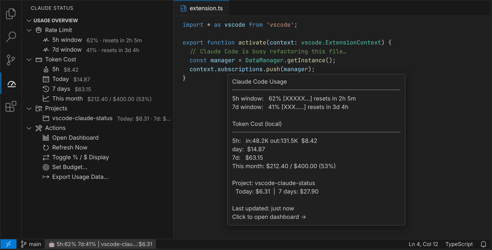
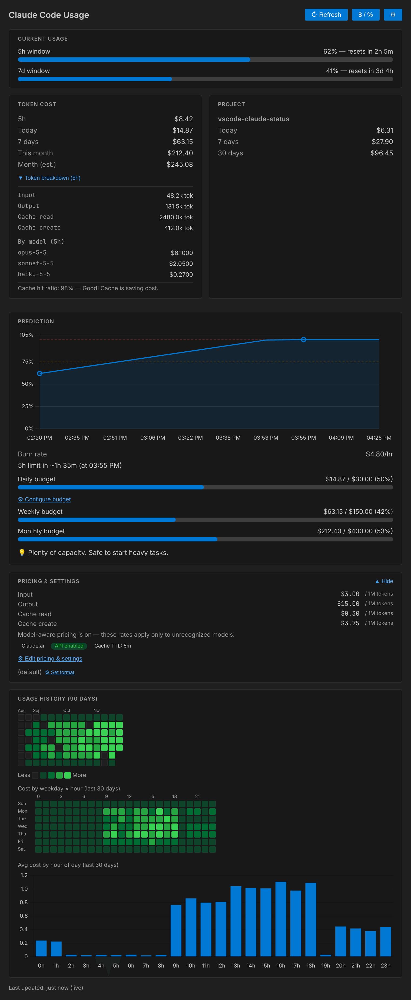

<div align="center">


# vscode-claude-status

**Claude Code token usage & cost — always visible in your VS Code status bar.**

[](https://marketplace.visualstudio.com/items?itemName=long-kudo.vscode-claude-status)
[](https://open-vsx.org/extension/long-kudo/vscode-claude-status)
[](https://marketplace.visualstudio.com/items?itemName=long-kudo.vscode-claude-status)
[](https://marketplace.visualstudio.com/items?itemName=long-kudo.vscode-claude-status)
[](https://code.visualstudio.com/)
<br>
[](LICENSE)
[](https://github.com/long-910/vscode-claude-status/actions/workflows/ci.yml)
[](https://github.com/long-910/vscode-claude-status/actions/workflows/release.yml)
[](https://github.com/sponsors/long-910)
[](https://ko-fi.com/long910)

🌐 **English** · [日本語](README.ja.md) · [中文](README.zh.md)



</div>

## Highlights

- **Rate limits at a glance** — 5-hour and 7-day utilization of your Claude.ai plan, right in the status bar.
- **What it costs** — token cost for the last 5 h, today, 7 days and this month, priced per model.
- **Per project** — how much the open workspace has cost today, this week and this month.
- **Ahead of the limit** — burn rate, time until the 5 h limit, and daily / weekly / monthly budgets with alerts.
- **Long-term patterns** — 90-day heatmap, hour-of-day chart and weekday × hour punch card.
- **Local and lightweight** — reads Claude Code's own transcripts; the only network call is a tiny rate-limit
  check, made only while Claude Code is in use ([details](#privacy--network-usage)).

## Quick Start

1. Install **Claude Status** from the [VS Code Marketplace](https://marketplace.visualstudio.com/items?itemName=long-kudo.vscode-claude-status)
   or [Open VSX](https://open-vsx.org/extension/long-kudo/vscode-claude-status).
2. Use Claude Code as usual — the status bar shows `🤖 5h:45% 7d:32%` (or your cost on pay-as-you-go plans).
   No setup or extra login is needed.
3. **Click the status bar item** for the dashboard, or open **Claude Status** in the Activity Bar.

---

## Features

### 📊 Status bar

A compact summary that is always visible. Hover it for the token breakdown and reset times; click it to open the dashboard.

| State | Example |
|-------|---------|
| Normal (% mode, Claude.ai) | `🤖 5h:45% 7d:62%` |
| Warning ≥ 75% | `🤖 5h:78%⚠ 7d:84%⚠` |
| Rate limit hit | `🤖 5h:100%✗` |
| Plan without a 7-day window | `🤖 5h:45%` |
| Cost mode | `🤖 5h:$14.21 7d:$53.17` |
| Pay-as-you-go (API key, Bedrock, usage-based Enterprise) | `🤖 5h:$0.15 7d:$0.42` |
| Pay-as-you-go, `payAsYouGo.showTimeWindows: false` | `🤖 Today:$0.15` |
| With meter (`statusBar.showSparkline`) | `🤖 5h:▰▰▰▱▱ 62% 7d:41%` |
| With project cost | `🤖 5h:78% 7d:84% \| my-app:$3.21` |
| Multi-root workspace (sum of folders) | `🤖 5h:78% 7d:84% \| PJ:$5.43` |
| Cached value (API unreachable or disabled) | `🤖 5h:78% 7d:84% [10m ago]` |
| Not logged in | `🤖 Not logged in` |

Want a different layout? `claudeStatus.statusBar.format` takes your own template — see [Configuration](#configuration).

### 🧭 Sidebar

The **Claude Status** icon in the Activity Bar opens a native tree view with the rate-limit windows,
token cost (5 h / today / 7 days / this month with the monthly budget), per-project cost, and quick actions —
the key numbers without opening the dashboard.

### 🗂 Dashboard

Click the status bar item (or **Claude Status: Open Dashboard**) for the full picture:

| Card | What it shows |
|---|---|
| **Current Usage** | 5 h and 7 d utilization bars with reset times |
| **Token Cost** | 5 h / today / 7 days / this month / month estimate; expandable token breakdown with per-model cost and cache hit ratio |
| **Project** | Today / 7 days / 30 days for each workspace folder |
| **Prediction** | Projected 5 h utilization until reset, burn rate, and daily / weekly / monthly budget bars |
| **Pricing & Settings** | Active token rates, provider, API state and cache TTL, with a link to the settings |
| **Usage History** | Daily heatmap, weekday × hour punch card, and average cost by hour of day |

It follows your light, dark or high-contrast VS Code theme.

<div align="center">

</div>

### 📁 Project cost

The open workspace folder is matched to its Claude Code session directory automatically, so you see what
**this project** has cost — today, in the last 7 days and in the last 30 days. Multi-root workspaces get one
breakdown per folder in the dashboard and a total in the status bar.

### 🔮 Prediction & budgets

From the last 30 minutes of activity the extension estimates when the 5 h limit will be reached and warns you
before it happens.

- **Burn rate** in $/hour and **time until the 5 h limit** (capped at the next reset)
- A hint such as *"Safe to start heavy tasks"* when more than 30 minutes remain
- Optional **daily**, **weekly** and **monthly** USD budgets with progress bars — the monthly one is handy for an
  Enterprise spend limit. Alerts fire at `claudeStatus.budget.alertThresholdPercent` (default 80 %) of the daily /
  monthly budget
- **Notifications**: a warning at ≤ 30 min, an error with *Open Dashboard* at ≤ 10 min; budget alerts at most once
  per day / month

Set the daily budget with **Claude Status: Set Budget…**, the others in Settings.

### 📅 Usage history

- **Daily heatmap** for the last 30 / 60 / 90 days (`claudeStatus.heatmap.days`) — hover a cell for its date and cost
- **Punch card** — cost by weekday × hour over the last 30 days, e.g. "Monday mornings"
- **Hour-of-day chart** — when you use Claude Code most
- **Export** the daily history as CSV or JSON with **Claude Status: Export Usage Data…**

---

## Supported Plans

The plan is detected automatically; no extra login is needed.

| Plan | Detected from | Status bar | Rate-limit API |
|---|---|---|---|
| Claude.ai Pro / Max, seat-based Team / Enterprise | `claude login` credentials (`~/.claude/.credentials.json` or the macOS Keychain) | `5h:45% 7d:32%` — the 7d part hides itself when the plan has no weekly window | at most once per 5 min, only while Claude Code is active |
| Usage-based Claude.ai plan (e.g. usage-based Enterprise) | Claude Code's account info (`billingType: "usage_based"` in `~/.claude.json`) | cost only | never |
| Anthropic API key | `ANTHROPIC_API_KEY` | cost only | never |
| AWS Bedrock | AWS environment variables | cost only | never |

On pay-as-you-go plans, `claudeStatus.payAsYouGo.showTimeWindows: false` shows today's cost instead of the
5h / 7d figures, and `claudeStatus.budget.monthlyUsd` tracks a spend limit. If detection picks the wrong plan,
set `claudeStatus.claudeProvider`. Details: [docs/PLANS.md](docs/PLANS.md).

> Developed and tested on a Claude.ai Pro plan; other plans are supported on a best-effort basis. Please
> [open an issue](https://github.com/long-910/vscode-claude-status/issues) with your plan type if something looks wrong.

---

## Privacy & Network Usage

**Token cost is computed locally** from `~/.claude/projects/**/*.jsonl` (or `claudeStatus.claudeHome`).
Nothing is uploaded. Only the rate-limit % of Claude.ai subscriptions needs the network; pay-as-you-go plans
never call the API.

> [!NOTE]
> **API calls are minimal and only happen while Claude Code is active.**
> The rate-limit API call fires only when a transcript (JSONL) was recently updated — when you stop using
> Claude Code, the extension stops calling the API entirely (unless you turn on `claudeStatus.realtime.enabled`).
> Each call uses ≈ 9 tokens of `claude-haiku-4-5` (≈ $0.00013), at most once per 5 minutes.
> Typical cost with default settings: **< $0.01 / month**.
> Set `claudeStatus.rateLimitApi.enabled: false` to stop all new API calls. If a prior cache exists, the
> last-fetched % is still shown with a `[Xm ago]` staleness indicator; without any cache, the display falls back
> to cost only.

> [!WARNING]
> **Cost figures are estimates** at Anthropic's list API prices (checked 2026-10-31). Negotiated discounts,
> seat fees and partner (Bedrock / Vertex) pricing are not included. Models newer than the built-in table are
> estimated from their family's latest rate; set exact rates with `claudeStatus.pricing.modelOverrides` —
> see [docs/PRICING.md](docs/PRICING.md).

---

## Requirements

- **VS Code 1.82** or newer
- **Claude Code** with at least one session

> [!IMPORTANT]
> **Since 0.9.0 the minimum VS Code version is 1.82 (was 1.73).** The rate-limit % uses the global `fetch` API,
> which the extension host only provides from VS Code 1.82 (Electron 25 / Node.js 18). On VS Code 1.73 – 1.81 it
> was never available, so subscribers saw `🤖 Not logged in` (or an old cached %) instead of their usage. On VS Code
> 1.81 or older, keep extension version 0.7.0, or update VS Code.

## Installation

**Marketplace** — search **"Claude Status"** in the Extensions view, or run:

```bash
code --install-extension long-kudo.vscode-claude-status
```

**VSIX** — download the `.vsix` from [Releases](https://github.com/long-910/vscode-claude-status/releases), then
**Extensions (Ctrl+Shift+X)** → **⋯** → **Install from VSIX…**

**From source**

```bash
git clone https://github.com/long-910/vscode-claude-status.git
cd vscode-claude-status
npm install
npx @vscode/vsce package   # → vscode-claude-status-<version>.vsix
```

---

## Commands & Shortcuts

The extension starts automatically when VS Code opens.

| Command / action | What it does |
|--------|--------|
| Click the status bar item | Open the dashboard |
| `Ctrl+Shift+Alt+C` (`⌘⇧⌥C` on Mac) | Toggle `%` ↔ `$` |
| **Claude Status: Open Dashboard** | Open the dashboard |
| **Claude Status: Refresh Now** | Refresh all data now |
| **Claude Status: Toggle % / $ Display** | Switch the status bar between % and cost |
| **Claude Status: Set Budget…** | Set or turn off the daily USD budget |
| **Claude Status: Export Usage Data…** | Save the daily usage history as CSV or JSON |

---

## Configuration

All settings live under `claudeStatus` in VS Code Settings. Full reference: [docs/SETTINGS.md](docs/SETTINGS.md).

### Display

| Setting | Default | Description |
|---------|---------|-------------|
| `claudeStatus.displayMode` | `"percent"` | `"percent"` or `"cost"` in the status bar |
| `claudeStatus.statusBar.alignment` | `"left"` | `"left"` or `"right"` |
| `claudeStatus.statusBar.showProjectCost` | `true` | Show the current project's cost in the status bar |
| `claudeStatus.statusBar.format` | `null` | Custom label, e.g. `"${usage5h}% \| $${costDay}"`. Placeholders: `${usage5h}`, `${usage7d}`, `${bar5h}`, `${bar7d}`, `${cost5h}`, `${cost7d}`, `${costDay}`, `${costMonth}`, `${reset5h}`, `${reset7d}` |
| `claudeStatus.statusBar.showSparkline` | `false` | Compact 5h meter (▰▰▰▱▱) next to the percentage |
| `claudeStatus.payAsYouGo.showTimeWindows` | `true` | Pay-as-you-go plans: `false` shows today's cost instead of 5h / 7d figures (subscriptions unaffected) |
| `claudeStatus.heatmap.days` | `90` | Days in the usage heatmap (30 / 60 / 90) |

### Plan, data source & API

| Setting | Default | Description |
|---------|---------|-------------|
| `claudeStatus.claudeProvider` | `"auto"` | `"auto"`, `"claude-ai"`, `"claude-ai-usage"` (usage-based Claude.ai plan), `"aws-bedrock"`, `"api-key"` |
| `claudeStatus.claudeHome` | `".claude"` | Claude Code data directory (relative to home; absolute and `~` work). User settings only |
| `claudeStatus.credentials.path` | `null` | Custom credentials file. User settings only |
| `claudeStatus.rateLimitApi.enabled` | `true` | Fetch rate-limit % (subscriptions). Off: no API calls; the last cached % stays visible with `[Xm ago]` |
| `claudeStatus.cache.ttlSeconds` | `300` | Rate-limit cache TTL (60–3600 s) |
| `claudeStatus.realtime.enabled` | `false` | Keep the rate-limit % fresh while Claude Code is idle too (at most every 5 min, ≈ 12 small API calls per idle hour) |

### Budgets & notifications

| Setting | Default | Description |
|---------|---------|-------------|
| `claudeStatus.budget.dailyUsd` | `null` | Daily budget in USD (`null` = off) |
| `claudeStatus.budget.weeklyUsd` | `null` | Budget for the last 7 days (dashboard bar) |
| `claudeStatus.budget.monthlyUsd` | `null` | Budget for the calendar month, e.g. an Enterprise spend limit |
| `claudeStatus.budget.alertThresholdPercent` | `80` | Warn at this % of the daily / monthly budget |
| `claudeStatus.notifications.budgetWarning` | `true` | Budget notifications (at most once per day / month) |
| `claudeStatus.notifications.rateLimitWarning` | `true` | Warn before the 5h limit is reached (subscriptions) |
| `claudeStatus.notifications.rateLimitWarningThresholdMinutes` | `30` | Minutes before exhaustion to warn (5–120) |

### Pricing

| Setting | Default | Description |
|---------|---------|-------------|
| `claudeStatus.pricing.useModelPricing` | `true` | Price each entry by its model with built-in rates |
| `claudeStatus.pricing.modelOverrides` | `{}` | Exact rates per model, e.g. `{ "claude-opus-6": { "inputPerMillion": 4, "outputPerMillion": 20 } }` |
| `claudeStatus.pricing.inputPerMillion` | `3.00` | Manual rates (USD / 1M tokens) for unrecognized models, or for everything when model pricing is off |
| `claudeStatus.pricing.outputPerMillion` | `15.00` | 〃 |
| `claudeStatus.pricing.cacheReadPerMillion` | `0.30` | 〃 |
| `claudeStatus.pricing.cacheCreatePerMillion` | `3.75` | 〃 |

### Examples

```jsonc
// Usage-based Enterprise with a $400 monthly spend limit
{
  "claudeStatus.payAsYouGo.showTimeWindows": false,   // 🤖 Today:$3.21 instead of 5h / 7d
  "claudeStatus.budget.monthlyUsd": 400,
  "claudeStatus.budget.dailyUsd": 30
}
```

```jsonc
// Claude.ai subscription: cost view, no outbound API calls
{
  "claudeStatus.displayMode": "cost",
  "claudeStatus.rateLimitApi.enabled": false
}
```

```jsonc
// Custom status bar label: 🤖 ▰▰▰▱▱ 62% · resets 2h 5m · today $14.87
{
  "claudeStatus.statusBar.format": "🤖 ${bar5h} ${usage5h}% · resets ${reset5h} · today $${costDay}"
}
```

---

## Troubleshooting

| Symptom | What to check |
|---|---|
| `🤖 Not logged in` | Run `claude login`. If your credentials file is elsewhere, set `claudeStatus.credentials.path`. On VS Code older than 1.82, update VS Code ([Requirements](#requirements)). |
| No % shown on a Claude.ai plan | Is `claudeStatus.rateLimitApi.enabled` on? On VS Code older than 1.82 the % cannot be fetched — see [Requirements](#requirements). |
| Wrong plan detected | Set `claudeStatus.claudeProvider` explicitly ([docs/PLANS.md](docs/PLANS.md)). |
| Cost stays at $0.00 | Claude Code's data is not in `~/.claude` — point `claudeStatus.claudeHome` at it. |
| Cost differs from your invoice | Figures are list-price estimates; set `claudeStatus.pricing.modelOverrides` for your rates. |

---

## Documentation

- [docs/](docs/README.md) — specifications, plan behaviour, pricing, the full settings reference
- [CHANGELOG.md](CHANGELOG.md) — what changed in each release
- [CONTRIBUTING.md](CONTRIBUTING.md) — development setup, tests, screenshots and releases

## Related Projects

- [claude-tmux-status](https://github.com/long-910/claude-tmux-status) — the same idea for the tmux status bar (Python)
- [vscode-view-charset](https://github.com/long-910/vscode-view-charset) — file encoding viewer for VS Code

## Contributing

Contributions are welcome — see [CONTRIBUTING.md](CONTRIBUTING.md). Thanks to everyone who has contributed!

[](https://github.com/long-910/vscode-claude-status/graphs/contributors)

## License

[MIT](LICENSE) — © 2026 long-910
