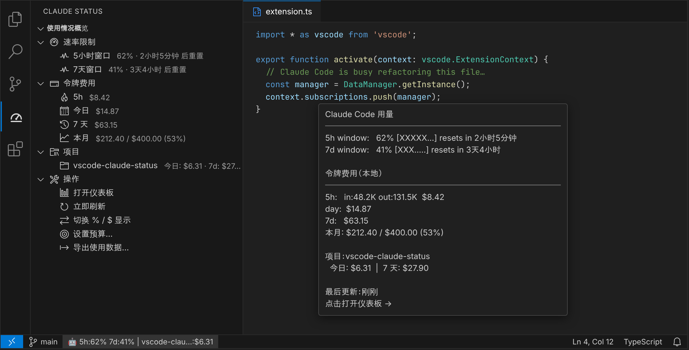
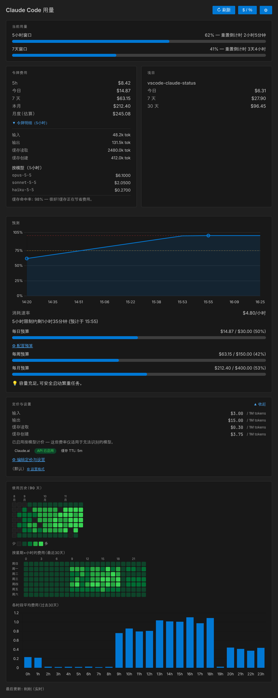

<div align="center">


# vscode-claude-status

**在 VS Code 状态栏中始终显示 Claude Code 的令牌用量与费用。**

[](https://marketplace.visualstudio.com/items?itemName=long-kudo.vscode-claude-status)
[](https://open-vsx.org/extension/long-kudo/vscode-claude-status)
[](https://marketplace.visualstudio.com/items?itemName=long-kudo.vscode-claude-status)
[](https://marketplace.visualstudio.com/items?itemName=long-kudo.vscode-claude-status)
[](https://code.visualstudio.com/)
<br>
[](LICENSE)
[](https://github.com/long-910/vscode-claude-status/actions/workflows/ci.yml)
[](https://github.com/long-910/vscode-claude-status/actions/workflows/release.yml)
[](https://github.com/sponsors/long-910)
[](https://ko-fi.com/long910)

🌐 [English](README.md) · [日本語](README.ja.md) · **中文**



</div>

## 亮点

- **速率限制一目了然** — 在状态栏显示 Claude.ai 方案的 5 小时与 7 天利用率
- **花了多少** — 最近 5 小时、今日、7 天和本月的令牌费用，按模型计价
- **按项目统计** — 当前工作区今日、本周和本月的费用
- **提前预警** — 消耗速率、距 5 小时限额的剩余时间，以及每日 / 每周 / 每月预算与提醒
- **长期趋势** — 90 天热力图、按小时图表和星期 × 小时打卡图
- **本地、轻量** — 只读取 Claude Code 自己的会话记录；唯一的网络请求是一次极小的速率限制查询，且仅在使用
  Claude Code 时发生（[详情](#隐私与网络)）

## 快速开始

1. 从 [VS Code Marketplace](https://marketplace.visualstudio.com/items?itemName=long-kudo.vscode-claude-status) 或
   [Open VSX](https://open-vsx.org/extension/long-kudo/vscode-claude-status) 安装 **Claude Status**
2. 照常使用 Claude Code — 状态栏会显示 `🤖 5h:45% 7d:32%`（按量付费方案显示费用）。无需任何配置或额外登录
3. **点击状态栏项**打开仪表板，或在活动栏中打开 **Claude Status** 侧边栏

---

## 功能

### 📊 状态栏

始终可见的简洁摘要。悬停查看令牌明细和重置时间，点击打开仪表板。

| 状态 | 示例 |
|------|------|
| 正常（% 模式，Claude.ai） | `🤖 5h:45% 7d:62%` |
| 警告 ≥ 75% | `🤖 5h:78%⚠ 7d:84%⚠` |
| 达到速率限制 | `🤖 5h:100%✗` |
| 没有 7 天窗口的方案 | `🤖 5h:45%` |
| 费用模式 | `🤖 5h:$14.21 7d:$53.17` |
| 按量付费（API 密钥、Bedrock、按量付费 Enterprise） | `🤖 5h:$0.15 7d:$0.42` |
| 按量付费，`payAsYouGo.showTimeWindows: false` | `🤖 Today:$0.15` |
| 带进度条（`statusBar.showSparkline`） | `🤖 5h:▰▰▰▱▱ 62% 7d:41%` |
| 带项目费用 | `🤖 5h:78% 7d:84% \| my-app:$3.21` |
| 多根工作区（各文件夹合计） | `🤖 5h:78% 7d:84% \| PJ:$5.43` |
| 缓存值（API 不可达或已关闭） | `🤖 5h:78% 7d:84% [10m ago]` |
| 未登录 | `🤖 Not logged in` |

可通过 `claudeStatus.statusBar.format` 自定义显示格式 — 参见[配置](#配置)。

### 🧭 侧边栏

活动栏中的 **Claude Status** 图标会打开原生树视图，显示速率限制窗口、令牌费用（5 小时 / 今日 / 7 天 / 本月及月预算）、
各项目费用和快捷操作 — 无需打开仪表板即可查看关键数据。

### 🗂 仪表板

点击状态栏项（或 **Claude Status: 打开仪表板**）即可查看全部信息：

| 卡片 | 内容 |
|---|---|
| **当前用量** | 5 小时和 7 天利用率进度条及重置倒计时 |
| **令牌费用** | 5 小时 / 今日 / 7 天 / 本月 / 月度估算；展开可查看令牌明细、按模型费用和缓存命中率 |
| **项目** | 每个工作区文件夹的今日 / 7 天 / 30 天费用 |
| **预测** | 至重置为止的 5 小时利用率预测图、消耗速率，以及每日 / 每周 / 每月预算进度条 |
| **定价与设置** | 当前令牌费率、提供方、API 状态、缓存 TTL，以及设置链接 |
| **使用历史** | 每日热力图、星期 × 小时打卡图、按小时平均费用 |

自动适配 VS Code 的浅色、深色和高对比度主题。

<div align="center">

</div>

### 📁 项目费用

自动将当前工作区文件夹对应到 Claude Code 的会话目录，显示**本项目**的费用 — 今日、最近 7 天和最近 30 天。
多根工作区在仪表板中按文件夹分别显示，状态栏显示合计。

### 🔮 预测与预算

根据最近 30 分钟的活动，估算何时达到 5 小时限额，并提前提醒。

- **消耗速率**（$/小时）与**距 5 小时限额的剩余时间**（以下次重置时间为上限）
- 剩余超过 30 分钟时给出"可安全启动繁重任务"等建议
- 可选的**每日**、**每周**、**每月** USD 预算及进度条 — 每月预算适合管理 Enterprise 的支出限额
- **通知**：剩余 ≤ 30 分钟时警告，≤ 10 分钟时弹出带"打开仪表板"的错误提示；预算提醒每天 / 每月最多一次

每日预算可通过 **Claude Status: 设置预算...** 设置，其他预算在设置中配置。

### 📅 使用历史

- **每日热力图** — 最近 30 / 60 / 90 天（`claudeStatus.heatmap.days`），悬停查看日期和费用
- **打卡图** — 最近 30 天按星期 × 小时的费用，例如"周一上午"
- **按小时图表** — 你最常使用 Claude Code 的时段
- **导出** — 通过 **Claude Status: 导出使用历史...** 将每日历史保存为 CSV 或 JSON

---

## 支持的方案

方案会自动识别，无需额外登录。

| 方案 | 识别依据 | 状态栏 | 速率限制 API |
|---|---|---|---|
| Claude.ai Pro / Max、席位制 Team / Enterprise | `claude login` 凭证（`~/.claude/.credentials.json` 或 macOS 钥匙串） | `5h:45% 7d:32%` — 没有每周窗口的方案自动隐藏 7d | 仅在 Claude Code 运行时，最多每 5 分钟一次 |
| 按量付费的 Claude.ai 方案（如按量付费 Enterprise） | Claude Code 账户信息（`~/.claude.json` 中的 `billingType: "usage_based"`） | 仅费用 | 从不调用 |
| Anthropic API 密钥 | `ANTHROPIC_API_KEY` | 仅费用 | 从不调用 |
| AWS Bedrock | AWS 环境变量 | 仅费用 | 从不调用 |

按量付费方案可通过 `claudeStatus.payAsYouGo.showTimeWindows: false` 显示今日费用代替 5h / 7d，
并通过 `claudeStatus.budget.monthlyUsd` 跟踪支出限额。识别有误时请设置 `claudeStatus.claudeProvider`。
详情：[docs/PLANS.md](docs/PLANS.md)（英文）。

> 作者在 Claude.ai Pro 方案上开发和测试；其他方案为尽力支持。如有异常，请附上方案类型
> [提交 Issue](https://github.com/long-910/vscode-claude-status/issues)。

---

## 隐私与网络

- **令牌费用在本地计算**，只读取 `~/.claude/projects/**/*.jsonl`（或 `claudeStatus.claudeHome`），不会上传任何内容。
- **仅速率限制 % 需要一次极小的 API 调用**（仅 Claude.ai 订阅）：每次约 9 个 `claude-haiku-4-5` 令牌（≈ $0.00013），
  最多每 5 分钟一次，且**仅在使用 Claude Code 时**。月均费用约 **< $0.01**。按量付费方案从不调用 API。
- 设置 `claudeStatus.rateLimitApi.enabled: false` 可完全停止 API 调用。上次缓存的 % 会附带 `[Xm ago]` 继续显示；
  无缓存时仅显示费用。

> [!WARNING]
> **费用为估算值**，按 Anthropic 的 API 标价（2026-10-31 核对）计算。不含协议折扣、席位费以及合作平台（Bedrock / Vertex）
> 的定价。比内置费率表更新的模型按同系列最新费率估算；可通过 `claudeStatus.pricing.modelOverrides` 设置准确费率 —
> 参见 [docs/PRICING.md](docs/PRICING.md)（英文）。

---

## 系统要求

- **VS Code 1.82** 或更高版本
- **Claude Code** 至少有一个会话

> [!IMPORTANT]
> 自 0.9.0 起最低版本为 VS Code **1.82**（此前为 1.73）：速率限制 % 使用全局 `fetch` API，扩展宿主从 1.82（Node.js 18）
> 起才提供。使用 VS Code 1.81 或更早版本时，请继续使用扩展 0.7.0，或更新 VS Code。

## 安装

**Marketplace** — 在扩展视图中搜索 **"Claude Status"**，或执行：

```bash
code --install-extension long-kudo.vscode-claude-status
```

**VSIX** — 从 [Releases](https://github.com/long-910/vscode-claude-status/releases) 下载 `.vsix`，然后
**扩展 (Ctrl+Shift+X)** → **⋯** → **从 VSIX 安装…**

**从源码构建**

```bash
git clone https://github.com/long-910/vscode-claude-status.git
cd vscode-claude-status
npm install
npx @vscode/vsce package   # → vscode-claude-status-<version>.vsix
```

---

## 命令与快捷键

扩展会在 VS Code 启动时自动运行。

| 命令 / 操作 | 作用 |
|------|------|
| 点击状态栏项 | 打开仪表板 |
| `Ctrl+Shift+Alt+C`（Mac 上为 `⌘⇧⌥C`） | 切换 `%` ↔ `$` |
| **Claude Status: 打开仪表板** | 打开仪表板 |
| **Claude Status: 立即刷新** | 立即刷新所有数据 |
| **Claude Status: 切换 % / $ 显示** | 切换状态栏的 % / 费用显示 |
| **Claude Status: 设置预算...** | 设置或关闭每日 USD 预算 |
| **Claude Status: 导出使用历史...** | 将每日使用历史保存为 CSV 或 JSON |

---

## 配置

所有设置均位于 VS Code 设置的 `claudeStatus` 下。完整参考：[docs/SETTINGS.md](docs/SETTINGS.md)（英文）。

### 显示

| 设置 | 默认值 | 说明 |
|------|--------|------|
| `claudeStatus.displayMode` | `"percent"` | 状态栏显示 `"percent"`（%）或 `"cost"`（$） |
| `claudeStatus.statusBar.alignment` | `"left"` | `"left"` 或 `"right"` |
| `claudeStatus.statusBar.showProjectCost` | `true` | 在状态栏显示当前项目费用 |
| `claudeStatus.statusBar.format` | `null` | 自定义标签，例如 `"${usage5h}% \| $${costDay}"`。占位符：`${usage5h}`, `${usage7d}`, `${bar5h}`, `${bar7d}`, `${cost5h}`, `${cost7d}`, `${costDay}`, `${costMonth}`, `${reset5h}`, `${reset7d}` |
| `claudeStatus.statusBar.showSparkline` | `false` | 在百分比旁显示紧凑的 5h 进度条（▰▰▰▱▱） |
| `claudeStatus.payAsYouGo.showTimeWindows` | `true` | 按量付费方案设为 `false` 时显示今日费用代替 5h / 7d（不影响订阅） |
| `claudeStatus.heatmap.days` | `90` | 使用历史热力图天数（30 / 60 / 90） |

### 方案、数据源与 API

| 设置 | 默认值 | 说明 |
|------|--------|------|
| `claudeStatus.claudeProvider` | `"auto"` | `"auto"`、`"claude-ai"`、`"claude-ai-usage"`（按量付费的 Claude.ai 方案）、`"aws-bedrock"`、`"api-key"` |
| `claudeStatus.claudeHome` | `".claude"` | Claude Code 数据目录（相对主目录；支持绝对路径和 `~`）。仅用户设置 |
| `claudeStatus.credentials.path` | `null` | 自定义凭证文件路径。仅用户设置 |
| `claudeStatus.rateLimitApi.enabled` | `true` | 获取速率限制 %（订阅）。关闭后不调用 API，继续显示上次缓存的 % 并附 `[Xm ago]` |
| `claudeStatus.cache.ttlSeconds` | `300` | 速率限制缓存 TTL（60–3600 秒） |
| `claudeStatus.realtime.enabled` | `false` | Claude Code 空闲时也保持速率限制 % 最新（最多每 5 分钟一次，每空闲小时约 12 次小型 API 调用） |

### 预算与通知

| 设置 | 默认值 | 说明 |
|------|--------|------|
| `claudeStatus.budget.dailyUsd` | `null` | 每日预算（USD，`null` = 关闭） |
| `claudeStatus.budget.weeklyUsd` | `null` | 最近 7 天的预算（仪表板进度条） |
| `claudeStatus.budget.monthlyUsd` | `null` | 自然月预算，例如 Enterprise 的支出限额 |
| `claudeStatus.budget.alertThresholdPercent` | `80` | 达到每日 / 每月预算的此百分比时提醒 |
| `claudeStatus.notifications.budgetWarning` | `true` | 预算通知（每天 / 每月最多一次） |
| `claudeStatus.notifications.rateLimitWarning` | `true` | 5h 限额即将用尽前提醒（订阅） |
| `claudeStatus.notifications.rateLimitWarningThresholdMinutes` | `30` | 提前多少分钟提醒（5–120） |

### 定价

| 设置 | 默认值 | 说明 |
|------|--------|------|
| `claudeStatus.pricing.useModelPricing` | `true` | 按模型使用内置费率计价 |
| `claudeStatus.pricing.modelOverrides` | `{}` | 按模型的准确费率，例如 `{ "claude-opus-6": { "inputPerMillion": 4, "outputPerMillion": 20 } }` |
| `claudeStatus.pricing.inputPerMillion` | `3.00` | 手动费率（USD / 百万令牌），用于无法识别的模型，或关闭按模型计价时的全部记录 |
| `claudeStatus.pricing.outputPerMillion` | `15.00` | 〃 |
| `claudeStatus.pricing.cacheReadPerMillion` | `0.30` | 〃 |
| `claudeStatus.pricing.cacheCreatePerMillion` | `3.75` | 〃 |

### 配置示例

```jsonc
// 每月支出限额 $400 的按量付费 Enterprise
{
  "claudeStatus.payAsYouGo.showTimeWindows": false,   // 显示 🤖 Today:$3.21 代替 5h / 7d
  "claudeStatus.budget.monthlyUsd": 400,
  "claudeStatus.budget.dailyUsd": 30
}
```

```jsonc
// Claude.ai 订阅：显示费用，不对外调用 API
{
  "claudeStatus.displayMode": "cost",
  "claudeStatus.rateLimitApi.enabled": false
}
```

```jsonc
// 自定义状态栏标签：🤖 ▰▰▰▱▱ 62% · 重置 2小时5分钟 · 今日 $14.87
{
  "claudeStatus.statusBar.format": "🤖 ${bar5h} ${usage5h}% · 重置 ${reset5h} · 今日 $${costDay}"
}
```

---

## 故障排查

| 现象 | 检查项 |
|---|---|
| 显示 `🤖 Not logged in` | 运行 `claude login`。凭证文件在其他位置时，设置 `claudeStatus.credentials.path` |
| Claude.ai 方案却不显示 % | 确认 `claudeStatus.rateLimitApi.enabled` 已开启。VS Code 低于 1.82 时无法获取（见[系统要求](#系统要求)） |
| 方案识别错误 | 显式设置 `claudeStatus.claudeProvider`（[docs/PLANS.md](docs/PLANS.md)） |
| 费用一直是 $0.00 | Claude Code 的数据不在 `~/.claude` — 用 `claudeStatus.claudeHome` 指定其位置 |
| 费用与账单不一致 | 显示的是标价估算；可在 `claudeStatus.pricing.modelOverrides` 中设置你的费率 |

---

## 文档

- [docs/](docs/README.md) — 规格说明、各方案行为、定价、完整设置参考（英文）
- [CHANGELOG.md](CHANGELOG.md) — 各版本的变更
- [CONTRIBUTING.md](CONTRIBUTING.md) — 开发环境、测试、截图与发布流程

## 相关项目

- [claude-tmux-status](https://github.com/long-910/claude-tmux-status) — 同样功能的 tmux 状态栏版本（Python）
- [vscode-view-charset](https://github.com/long-910/vscode-view-charset) — VS Code 文件编码查看器

## 贡献

欢迎贡献 — 请参阅 [CONTRIBUTING.md](CONTRIBUTING.md)。感谢所有贡献者！

[](https://github.com/long-910/vscode-claude-status/graphs/contributors)

## 许可证

[MIT](LICENSE) — © 2026 long-910
