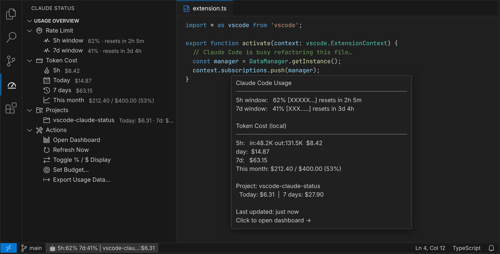

# Feature 01: Status Bar Display

Source: [`src/statusBar.ts`](../../src/statusBar.ts)

## Purpose

Always-visible Claude Code usage summary in the VSCode status bar (bottom bar).
Lightweight, non-blocking, updates automatically.



---

## Display Format

The label is built by `buildLabel()`. `| my-app:$3.21` is appended whenever
`statusBar.showProjectCost` is on and the workspace has project data
([Feature 03](03-project-cost.md)); a multi-root workspace shows the sum as `| PJ:$5.43`.

| State | Label |
|---|---|
| Percent mode (`claude-ai`, `displayMode: "percent"`) | `🤖 5h:78% 7d:84%` |
| Warning (≥ 75 % utilization) | `🤖 5h:78%⚠ 7d:84%⚠` |
| Denied (limit reached) | `🤖 5h:100%✗` |
| Plan without a 7-day window | `🤖 5h:45%` |
| Meter (`statusBar.showSparkline: true`, percent mode) | `🤖 5h:▰▰▰▱▱ 62% 7d:41%` |
| Cost mode (`displayMode: "cost"`, or any non-`claude-ai` provider) | `🤖 5h:$14.21 7d:$53.17` |
| Pay-as-you-go with `payAsYouGo.showTimeWindows: false` | `🤖 Today:$14.21` |
| Stale (cache expired, or `rateLimitApi.enabled: false` with a cache) | `🤖 5h:78% 7d:84% [32m ago]` |
| No data yet | `🤖 Claude: run refresh` |
| No credentials | `🤖 Not logged in` |

The stale age uses the shared duration format: `32m`, `2h 15m`, `1d 3h`
([`formatDuration.ts`](../../src/webview/formatDuration.ts)).

Which of these appears for each plan is listed in
[PLANS.md](../PLANS.md#what-each-provider-shows). In short: percentages only for `claude-ai`;
every other provider is always in cost mode.

---

## Status Bar Item

- Created once in `StatusBarManager` with priority 100 on the left (or right, per
  `claudeStatus.statusBar.alignment`).
- `name` is *Claude Code Usage* (read by screen readers); clicking runs
  `vscode-claude-status.openDashboard`.
- Shows `🤖 Claude: loading...` until the first data arrives.

---

## Color Coding

Theme color IDs only, never hex values (`applyColor()`):

| State | Background | Foreground |
|-------|-----------|------------|
| Normal (< 75 %) | — | — (default) |
| Warning (`limitStatus: allowed_warning`) | `statusBarItem.warningBackground` | `statusBarItem.warningForeground` |
| Denied (`limitStatus: denied`) | `statusBarItem.errorBackground` | `statusBarItem.errorForeground` |
| Stale data | — | `descriptionForeground` (dimmed) |
| No credentials | `statusBarItem.errorBackground` | `statusBarItem.errorForeground` |
| Non-`claude-ai` provider | — | — (no rate limits, so never warning / error) |

---

## Tooltip (hover text)

A `\n`-separated plain-text string built by `buildTooltip()`. For a Claude.ai subscription:

```
Claude Code Usage
─────────────────────────────
5h window:   78% [XXXXXX..] resets in 2h 47m
7d window:   84% [XXXXXXX.] resets in 4d 8h

Token Cost (local)
─────────────────────────────
5h:   in:38.5K out:127.8K  $14.21
day:  $14.21
7d:   $53.17
This month: $121.40 / $400.00 (30%)     ← "/ budget (%)" only with budget.monthlyUsd

Project: my-app
  Today: $3.21  |  7 days: $18.45

Last updated: just now
Click to open dashboard →
```

Differences for other cases:

- **Non-`claude-ai` provider** — the rate-limit block is replaced by a `Claude Code (AWS Bedrock)` /
  `(API Key)` / … header; the cost block is unchanged.
- **`payAsYouGo.showTimeWindows: false`** — the cost block shows only `Today:` and `This month:`
  ([PLANS.md](../PLANS.md#pay-as-you-go-usage-based-claudeai-api-key-bedrock)).
- **No credentials / no data** — a short message (`Run: claude login` / `Click to open dashboard →`).

---

## Update Timing

| Event | Action |
|-------|--------|
| Extension activation | Read cache → update immediately |
| JSONL file change (FileWatcher) | `DataManager.refresh()` → update |
| Timer (every 60 seconds, `src/extension.ts`) | `getUsageData()` re-renders from cache and calls the API only when one is due ([PLANS.md](../PLANS.md#rate-limit-api-calls-claude-ai-only)); fresh API data is republished to every surface, and the sidebar is refreshed so "resets in" countdowns stay current |
| User clicks "↻ Refresh" in the dashboard | `DataManager.forceRefresh()` → update |

---

## Custom Format (`claudeStatus.statusBar.format`)

A template string replaces the generated label:

```jsonc
"claudeStatus.statusBar.format": "Claude Usage 5h:${usage5h}% 7d:${usage7d}%"
// → Claude Usage 5h:35% 7d:72%
```

Placeholders (`${usage5h}`, `${bar5h}`, `${costDay}`, `${costMonth}`, `${reset5h}`, …) are listed in
[SETTINGS.md](../SETTINGS.md#placeholders).

### Priority and fallback rules

1. `no-credentials` / `no-data` states → always use default messages, format is ignored.
2. `format` is set and non-empty → `applyFormat()` returns the interpolated string.
3. `format` is `null` (default) → `buildLabel()` (mode, provider, stale suffix, project cost).

The stale-age suffix and project cost suffix are **not** appended in custom format mode.
Color coding is unaffected — it still follows `limitStatus`.

---

## Display Toggle (Cost Mode)

Command `vscode-claude-status.toggleDisplayMode` (`Ctrl+Shift+Alt+C` / `⌘⇧⌥C`) switches between
percent and cost mode and stores the choice in `claudeStatus.displayMode`, so it survives restarts.

---

## Accessibility

- `name = 'Claude Code Usage'` for screen readers
- The tooltip conveys everything shown in the label
- State is never conveyed by color alone (text indicators ⚠ ✗)
