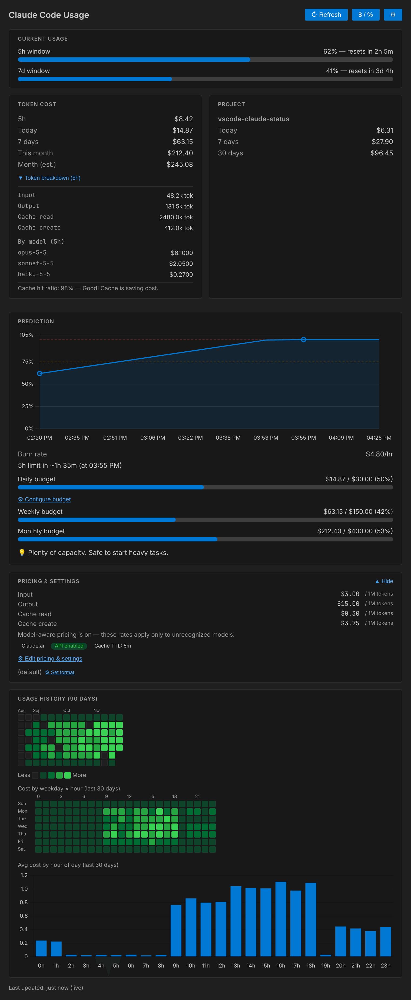

# Feature 02: WebView Dashboard Panel

Source: [`src/webview/panel.ts`](../../src/webview/panel.ts)

## Purpose

Rich visual dashboard that opens when the user clicks the status bar item.
Shows all usage data in a single scrollable panel. VSCode-native look and feel
using CSS variables from the active theme.



---

## Panel Specification

- `createWebviewPanel('claudeStatusDashboard', …, ViewColumn.Beside)` — opens to the right of the
  active editor.
- `enableScripts: true`, `retainContextWhenHidden: true` (keeps state while the tab is hidden),
  `localResourceRoots: []` (no local file access).
- Only one panel at a time; opening it again calls `panel.reveal()`.
- While the panel is open, `DataManager.setDashboardOpen(true)` keeps the heatmap fresh.

---

## Content Security Policy

```
default-src 'none';
script-src 'nonce-${nonce}' https://cdn.jsdelivr.net;
style-src 'unsafe-inline';
img-src data:;
connect-src 'none';
```

`nonce` is a random 16-byte hex string generated per panel. Every `<script>` tag carries it;
Chart.js is loaded from jsDelivr at a pinned version (`chart.js@4.4.0`).

### CSP and event handlers

The CSP blocks inline `onclick="…"` (and every other inline event attribute). **Never** use them:
attach listeners in the script block, and use document-level delegation for generated elements.

```javascript
document.addEventListener('click', e => {
  if (e.target && e.target.id === 'budget-save-btn') { saveBudget(); }
});
```

Give dynamically created buttons a unique `id` so the delegation handler can identify them.

---

## Layout

Cards from top to bottom (see the screenshot above):

| Card | Content |
|---|---|
| Header | Title and buttons `↻ Refresh` (force refresh with spinner), `$ / %` (toggle display mode), `⚙` (open settings filtered to `claudeStatus`) |
| **Current Usage** | 5 h and 7 d progress bars with "resets in" — hidden for pay-as-you-go with `showTimeWindows: false` |
| **Token Cost** | 5 h / today / 7 d / this month / month estimate, and the collapsible [token breakdown](#token-breakdown-collapsible) |
| **Project** | One block per workspace folder ([Feature 03](03-project-cost.md)) |
| **Prediction** | [Rate limit timeline chart](#rate-limit-timeline-chart), burn rate, budgets and recommendation ([Feature 04](04-prediction.md)) |
| **Pricing & Settings** | See [below](#pricing--settings-card) |
| **Usage History** | Heatmap, punch card, hourly chart ([Feature 05](05-heatmap.md)) |
| Footer | `Last updated: just now (live)` — `(stale)` when the rate-limit data is old |

Progress bars are plain CSS (`.progress-track` / `.progress-fill`, with `.warning` and `.error`
variants). All colours come from VS Code theme variables (`--vscode-editor-background`,
`--vscode-progressBar-background`, `--vscode-editorWarning-foreground`, …), so the panel follows
light, dark and high-contrast themes without extra code.

---

## Message Protocol (Extension ↔ WebView)

### Extension → WebView

| `type` | Payload |
|---|---|
| `update` | `data: DashboardMessage` — see below |
| `setDisplayMode` | `mode: 'cost' \| 'percent'` |

`DashboardMessage` (`panel.ts`):

| Field | Content |
|---|---|
| `usage` | `ClaudeUsageData` ([ARCHITECTURE.md](../ARCHITECTURE.md)) |
| `projectCosts` | `ProjectCostData[]` (multi-root aware) |
| `prediction` | `PredictionData \| null` |
| `heatmap` | `HeatmapData \| null` (null until first computed) |
| `monthEstimate` | `projectMonthCost(costMonth)` — month-to-date pace × days in the month |
| `pricing` | Manual `claudeStatus.pricing.*` rates |
| `settings` | Provider and label, `apiEnabled`, `cacheTtlSeconds`, `weeklyBudget`, `monthlyBudget`, `statusBarFormat`, `useModelPricing`, `showTimeWindows` |

### WebView → Extension

| `type` | Sent when | Extension does |
|---|---|---|
| `ready` | script loaded | Sends an update at once, then starts the heatmap computation and sends a second update when it finishes |
| `refresh` | `↻ Refresh` | `DataManager.forceRefresh()` |
| `toggleMode` | `$ / %` | Flips `claudeStatus.displayMode`, replies with `setDisplayMode` |
| `setBudget` | budget form saved (`amount`, `null` = off) | Writes `claudeStatus.budget.dailyUsd`, then `forceRefresh()` |
| `setFormat` | format editor saved (`format`, `null` = default) | Writes `claudeStatus.statusBar.format`, then `refresh()` |
| `openSettings` | `⚙` / settings links | Opens the Settings UI filtered to `claudeStatus` |

---

## Refresh Behavior

1. `↻ Refresh` shows a spinner and disables the button, then posts `refresh`.
2. `DataManager.forceRefresh()` runs; `onDidUpdate` fires and the extension posts `update`.
3. The WebView re-renders and removes the spinner.

The heatmap is computed in the background: the first `update` may carry the cached heatmap (or
`null`), and a second `update` follows once it is ready. `DataManager.getHeatmapData()` keeps the
result in memory for 5 minutes; `forceRefresh()` invalidates it.

---

## Rate Limit Timeline Chart

A Chart.js line chart (`<canvas id="predChart">`) in the Prediction card shows the projected 5 h
utilization until the window resets.

**Visibility:** only when `providerType === 'claude-ai'`, `utilization5h > 0` and `resetIn5h > 0`.

**Data construction:**

1. About 8 evenly spaced time points from now to the reset (`resetIn5h`).
2. If `estimatedExhaustionIn` is set, that exact minute is added as a point.
3. For each point at `t` minutes from now:
   - `t >= exhaustMin` → 100 %
   - otherwise `currentPct + (100 − currentPct) × (t / exhaustMin)` (linear)
   - no exhaustion predicted → `currentPct` (flat)
4. Reference lines at 75 % (warning, dashed) and 100 % (limit, dashed).

The line is red from 90 %, amber from 75 %, otherwise the theme's progress-bar colour. Y axis
0–105 %, absolute time labels, legend hidden, tooltip only on the projection.

---

## Token Breakdown (collapsible)

`▶ Token breakdown (5h)` in the Token Cost card reveals per-type token counts:

| Row | Formula (manual pricing) |
|-----|---------|
| Input | `tokensIn5h / 1M × pricing.inputPerMillion` |
| Output | `tokensOut5h / 1M × pricing.outputPerMillion` |
| Cache read | `tokensCacheRead5h / 1M × pricing.cacheReadPerMillion` |
| Cache create | `tokensCacheCreate5h / 1M × pricing.cacheCreatePerMillion` |
| Cache hit ratio | `tokensCacheRead5h / (tokensIn5h + tokensCacheRead5h) × 100` |

When `claudeStatus.pricing.useModelPricing` is on (default) the manual rates don't apply to most
entries, so the rows show token counts only and a **By model (5h)** list shows
`usage.costByModel5h` (model id shortened, e.g. `claude-sonnet-4-5-20250929` → `sonnet-4-5`),
sorted by cost. Models not priced from the built-in table are flagged from
`usage.pricingByModel5h`: `≈` = estimated (newer than the table), `*` = manual rates or a
`modelOverrides` entry; the label's tooltip explains which.

The breakdown re-renders on every `update` while it is open.

---

## Pricing & Settings Card

Expanded by default (toggle `▲ Hide` / `▼ Show`):

- **Pricing grid** — the four `claudeStatus.pricing.*` rates; with `pricing.useModelPricing` on, a
  note says they apply only to unrecognized models
- **Badges** — provider, `rateLimitApi.enabled` state, cache TTL in minutes
- **⚙ Edit pricing & settings** — posts `openSettings`
- **Status bar format** — the current `statusBar.format` (or *default*) with an inline editor that
  posts `setFormat`

The card re-renders on every `update`, open or closed, so it always shows the live settings.
